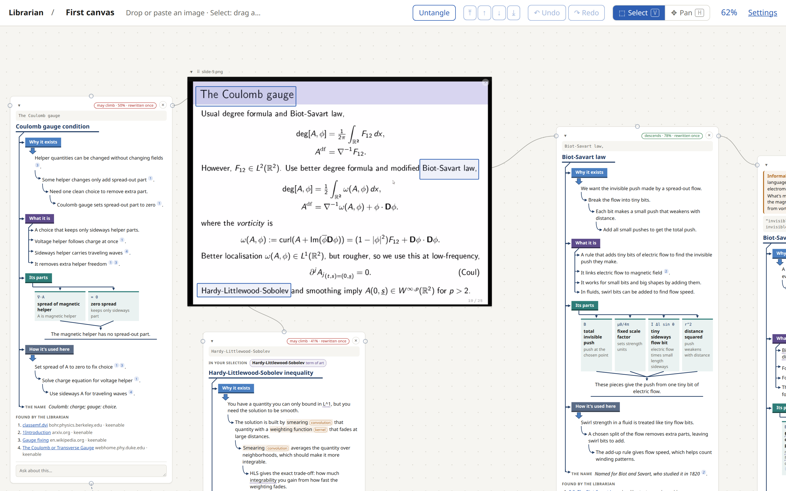
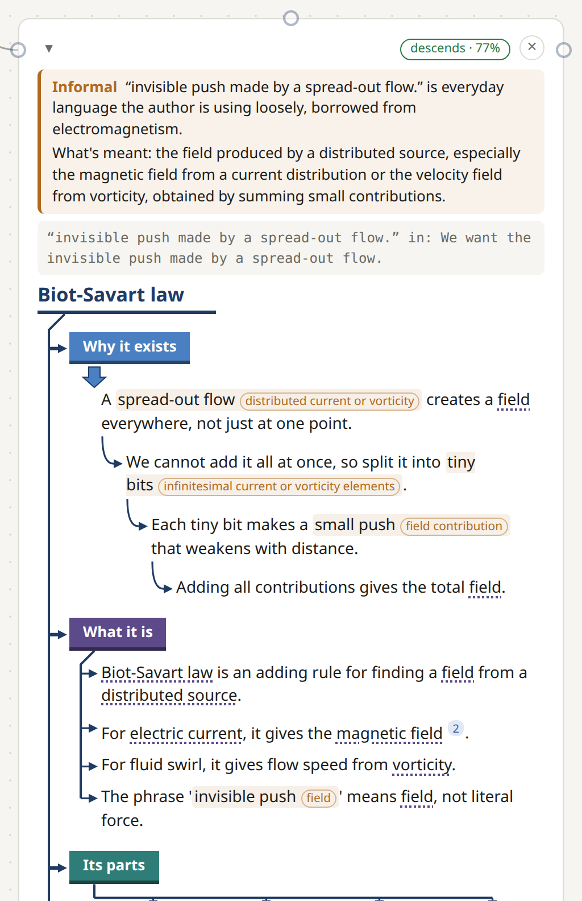
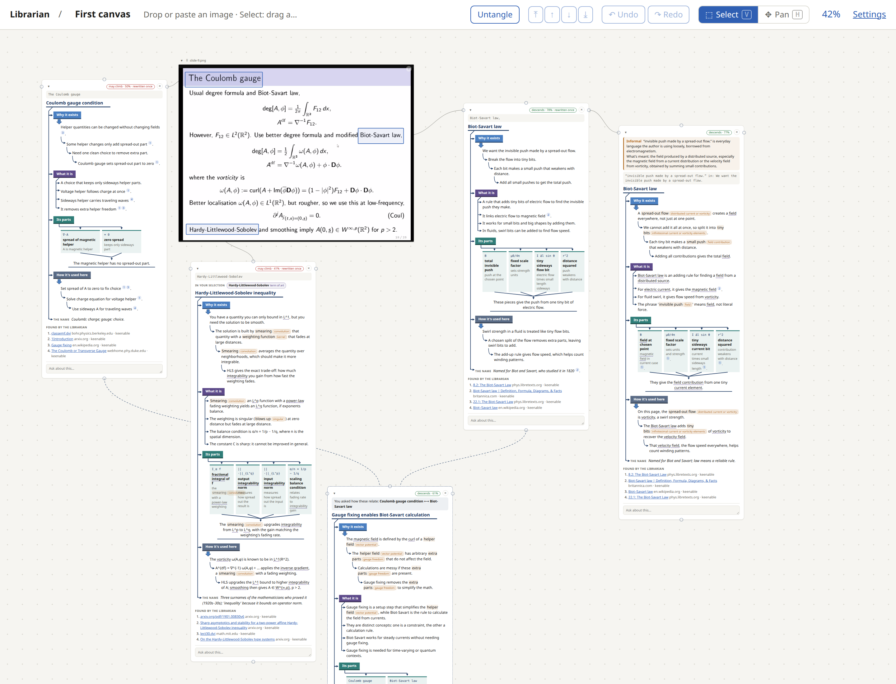

# Librarian

**A research librarian with unlimited time, on an infinite desk that never gets rearranged.**

**Try it: [librarian.9ol.es](https://librarian.9ol.es).** Free, unlimited, no account needed. Sign in only if you want to keep your canvases.



## The pain

You're curious about something hard. Maybe you're on a Zoom call watching a research talk, and slide 8 says the *Ampère tension field* is what keeps the *Chern-Simons-Schrödinger* system *well-posed in the energy class*. You can read every word. You understand none of it.

That isn't because the ideas are unknowable. Four things get in the way:

**The jargon loop.** Ask what a term means, and the answer uses harder terms, each defined by harder ones still. It's like sitting in Spanish I, asking what a word means, and being answered in Spanish II, then III, then IV, until you're holding a pile of words you don't know. Defining the general through the more specialized is always the wrong direction.

**You can't tell strict words from casual ones.** Mathematical writing switches without warning between terms with exact definitions ("energy space", "well-posed") and loose talk ("+ better", "the worst term", "rougher"). Even the symbols do it: put quote marks around ≲ and it means "roughly". Insiders hear the difference instantly. To an outsider they're all just English words. It's like a fan convention where someone quotes a line from season 4, episode 5, everyone laughs, and you're left asking what show this is.

**Nothing meets you where you are.** Textbooks start years before the slide you care about. Papers and Wikipedia start after it, and Wikipedia's mathematics is a Spanish–Spanish dictionary when you need Spanish–English. "Do I need to explain negative numbers to you?" is a false choice: the ask was never to explain everything, only to stop explaining down-the-hall ideas with across-town ones.

**The tools are built for skimming.** Tabs multiply and you lose the thread. A chat scrolls away into 500k tokens you'll never find again. Brilliant and Duolingo made learning engaging, but over a fixed, shallow curriculum, so people plateau at level 2.

Self-directed deep study does work somewhere: a library, with a good reference librarian who has time for you. That's what this is trying to be.

## What it does

Bring whatever stopped you:

- **A screenshot** of a slide, a page or a figure: drop or paste it, then drag a box over the part you don't get.
- **A link** to a Wikipedia page or an article: it's read whole and drawn as shapes. First an overview of the whole page, then **the whole page, section by section**, restructured into shapes without losing anything: every claim, number, name and example is carried by some piece, each piece points at the paragraphs it came from (¶), the page's figures sit with the text they illustrate, and anything the restructuring missed is kept as written. You can flip to the page's own text at any time.
- **An arXiv paper:** search arXiv from the toolbar and lay its pages out on the canvas.
- **A question** typed in your own words.
- **A YouTube lecture**, which plays right on the canvas (see below).

The home page has one-click examples: a 3Blue1Brown lecture on eigenvectors, Wikipedia's eigenvectors page, a tutorial on spectral clustering, the Hamiltonian, the breakup of Yugoslavia, and the synaptic vesicle cycle.

The librarian may first ask one short question about where you're coming from and what you're after, and pitches everything after to your answer. Then it **looks for introductory material first** (lecture notes, textbook chapters, Khan Academy, Britannica) and draws an explanation beside what you pointed at, starting with *why the thing exists* and citing what it found.

Explanations are drawn as diagrams, not paragraphs: why it exists as a chain of steps, what it is, a formula split into its parts and joined back together, how it's used on this page (or, for a question, how it unfolds), and what its name means. Math is rendered properly, and selecting a formula sends its LaTeX.

**Explanations descend toward what you know, never climb.** Select any words in an explanation, or click a dotted-underlined term, to go one level further down. A fast decision model checks each draft for climbing into harder jargon than the thing it explains, and asks for a rewrite if it does.

### Grow the diagram from any piece

Every piece of a diagram, and every section heading, has a **+**. Pick the shape you want more in, drawn from the VizShapes vocabulary: **Say more** (an aside), **Why?** (a path of reasons), **Then what?**, **Steps** (a numbered procedure), **Break it down** (parts and what they add up to), **Two ways** (a fork), or **For example**. Or just say what you want, and the librarian picks the shape that answers it. Select words in the piece first to grow from those words. Whatever grows has its own +, so you can keep going as deep as you like.

### It points at the page

When an explanation says "the second equation" or "the diagram", the part of the slide it means is cut out and shown right under that piece. Hover it and the spot lights up on the slide itself.

### Stop a lecture where it loses you

Paste a YouTube link and the video plays on the canvas. When something goes by that you don't follow, press **Stop here and ask**: the exact frame lands beside the video, sharp enough to read the board, with what the lecturer was saying around that moment. Box anything in the frame or select words from the transcript to go down, and the explanation knows what was being said. Each moment's **▶** takes the video back there. Videos whose owners don't allow embedding play from the librarian's own copy instead (720p at most), with the download shown as it goes.

### PDFs

Paste a link to a PDF (an arXiv paper, or any `.pdf`) and its pages land on the canvas, ten to a row, up to the first 80. Each is that page alone, as a single-page PDF sliced from the original with poppler: drawn sharp at any zoom, with its real text. Drag across words to select a paragraph and explain it, worded exactly as the PDF has it; drag around a figure or an equation to box it, as on any image. Each page links back to the PDF at that page.

### Notebooks

Ask for an example in a notebook ("can you give me an example of this in a Jupyter notebook?", in a card's chat or out loud on a call) and a notebook opens beside the canvas. The librarian looks for a real one first: notebooks people wrote and ran, found on GitHub, course sites and nbviewer, of which it keeps the cells that make a focused example, word for word, credited and linked. Only if none fits does it write one, and the notebook says so.

Python notebooks run right there, in the browser (Pyodide: numpy, scipy, matplotlib, sympy, pandas, scikit-learn and more), and you can edit and re-run any cell (Shift+Enter). Notebooks in other languages (Julia, R…) show the results their author got, with a link to run the original live on Binder. The notebook also sits on the canvas as a card, next to what it's about.

### Call the librarian

Press **Call** and just talk while you work: there's no button to hold. The microphone stays open and hears when you start and stop speaking, so your hand stays on the canvas. Point at any piece of a diagram, a card, or words you've selected while you ask out loud: "break this down", "why is that?", "what does this word mean?". The librarian answers in a sentence or three, out loud, and changes the canvas as it talks: it grows the piece you're pointing at in the shape your question calls for, opens a deeper card on a phrase, finds videos, reading, papers or an example notebook (or draws a diagram) and puts them beside what you're on, or takes cards off the canvas ("get rid of those two diagrams"; Undo brings them back), several of these in one go if you ask for several ("can you find some videos about eigenvectors?"). Select words and "this part right here" means them: the selection goes over with the sentence it's in, even if a click cleared it just before you spoke. The piece you're pointing at is outlined while you're on a call, so "this" is never ambiguous. Talking over the librarian stops it, and **M** mutes.

Calls use the browser's own speech recognition and voice where it has them (Chrome, Edge and Safari do): words show as you say them and the answer starts speaking at once. A natural voice can be picked in the call bar when the server has one, and browsers without recognition (Firefox) send audio to the server's. Those speech servers are optional, set with `LIBRARIAN_TTS_URL` (an OpenAI-compatible `/v1/audio/speech`, such as [Kokoro](https://huggingface.co/hexgrad/Kokoro-82M)) and `LIBRARIAN_STT_URL` (a `/transcribe` endpoint that takes raw audio and returns `{"text"}`, such as [faster-whisper](https://github.com/SYSTRAN/faster-whisper) behind a few lines of Python). `LIBRARIAN_VOICE` picks the voice (`af_heart` by default). Without them, calls use only the browser's speech.

### Where an idea is taught

Each explanation notes the courses that teach its subject, and those that assume it, found among the pages it searched: say *MIT 18.06* and *Purdue MA262* for eigenvectors, at an intro undergraduate level. The sightings build up across every canvas into a map of where ideas sit in the curriculum, the start of flagging explanations that reach ahead of you.

### It tells you which words are strict and which are loose



Before explaining what you selected, the librarian decides whether it's a **term of art**, an **insider idiom**, **informal language**, or **loosened notation**. For loose language it says what's actually meant. Its own plain-language stand-ins ("small push", "tiny bits") are tagged with the real term they replace, so you learn the vocabulary as you go. Strict terms get a dotted underline.


When you box part of a page, it lists the phrases in your selection by register before it explains anything.

### Ask how two things are related



Drag from the dot on any card's edge onto another card. You aren't claiming they're related; you're asking. A relation card appears between them with the connecting idea, or an honest "they're distinct concepts" when the link is weak.

### Ask about anything, right where it is


Every card has an "Ask about this" box. The conversation stays on that card, and the model gets everything the card knows: the page, how you got there, the explanation, and its sources. No scrolling back through one endless chat.

### The desk stays put

- **Nothing moves unless you move it.** The canvas never reshuffles. Drag cards and images anywhere, and everything hanging off them comes along. An explanation can sit on any side of what it explains, just not on top of it.
- **Nothing is lost.** Every change is an event in an append-only log. Undo and Redo cover adding, moving, removing, collapsing and restacking. Removing hides; it never deletes.
- **Goals (experimental).** What you're after, kept as a tree beside the canvas: each card the librarian makes is placed under the goal it serves, under a subgoal (something that goal turned out to need), or under a detour (curiosity off to the side). Click a goal to walk through its cards; reword one (what it was is kept), mark it done, or clear it.
- **Figures.** Ask a card (or a call) for data, a plot or a graph. Data becomes a table read off real pages, credited, flagged when any of it came from the model's memory; it charts itself and copies as CSV. A plot draws functions, curves in t and points on axes, with the key points called out and values under the cursor. A graph draws nodes and edges: layered when it's a hierarchy, in its standard drawing when it's a named graph, and you can drag the nodes. The model writes each as data and the math is parsed, never run. Asking again on the card ("log scale", "add cos x") changes it, and the earlier one can be brought back.
- **Walk the tree.** Collapse any card or image to fold away everything below it. Untangle pushes overlapping cards apart. Bring to front and send to back work as you'd expect.
- **Named canvases with stable URLs** at `/c/<id>`, so you can bookmark a line of inquiry and come back to it. A canvas you don't name is named after what you started it with.
- **You can see it working.** A selection being explained is highlighted where you made it, a placeholder shows where its card will land, and work happening out of view gets a pointer at the edge of the screen.
- **It works on a phone,** with pinch to zoom and one-finger panning.

### Your models, your sources


- **Language model:** any OpenAI-compatible endpoint, such as OpenAI, Anthropic, OpenRouter, LiteLLM, Ollama or vLLM. It needs to read images.
- **Decision model (optional):** a System One endpoint such as TypeSafe's Jev, for the fast typed checks: does this climb, is this word strict or casual.
- **Diagram model (optional):** another model to draw the SVG diagrams you ask for, since some models draw far better than they write. Leave its base URL blank to use the language model's server and key with just a different model name.
- **Searchers:** Keenable works with no key. SearXNG, Brave, Exa, Perplexity Sonar, Parallel, You.com and Tavily take your keys.

Keys stay on your machine in `data/config.json` (mode 600, gitignored). The browser never sees them.

## Run

```bash
npm install
npm run dev
```

Videos need [yt-dlp](https://github.com/yt-dlp/yt-dlp) (a recent one: YouTube's protections change often) and [ffmpeg](https://ffmpeg.org) on the server, and Node for yt-dlp's JavaScript runtime. YouTube sometimes refuses servers as bots ("Sign in to confirm you're not a bot"); then stopping a lecture fails until the server has cookies from a browser signed in to YouTube: export them in Netscape format (yt-dlp's [guide](https://github.com/yt-dlp/yt-dlp/wiki/Extractors#exporting-youtube-cookies)) to `data/youtube-cookies.txt`, or point `LIBRARIAN_YTDLP_COOKIES` at the file. It's picked up within a minute, no restart needed.

Then open http://localhost:5173, set up a model under **Settings**, and press **Test**. For a production build, run `npm run build && npm start`, which serves everything from port 8787.

Shortcuts: **/** to start something new, **V** for select and **H** for pan. Hold **Space** to pan. Ctrl+scroll zooms. **Ctrl+Z** and **Ctrl+Shift+Z** undo and redo. **Ctrl+]** and **Ctrl+[** restack, and adding Shift goes all the way to the front or back.

## Hosting it for other people

Run locally, Librarian has no accounts: it's yours. To put it on a server for others, turn accounts on. Visitors can then use everything straight away without signing in; signing in (anyone can sign up) is only for keeping their canvases, and whatever they made before comes with them. Each person sees only their own canvases, and only admins can see or change the models and searchers that everyone shares.

```bash
npm install && npm run build
LIBRARIAN_AUTH=on \
BETTER_AUTH_URL=https://librarian.example.org \
BETTER_AUTH_SECRET=$(openssl rand -hex 32) \
ADMIN_EMAILS=you@example.org \
npm start
```

- **Email and password** sign-up works immediately, with no email service.
- **GitHub and Google** sign-in buttons appear when you set `GITHUB_CLIENT_ID` and `GITHUB_CLIENT_SECRET`, or `GOOGLE_CLIENT_ID` and `GOOGLE_CLIENT_SECRET`. Both are free OAuth apps. Register their callback URLs as `https://<your domain>/api/auth/callback/github` and `.../google`.
- **A domain with HTTPS** is needed for the OAuth providers. The server listens on 127.0.0.1:8787, so put a reverse proxy in front of it. With [Caddy](https://caddyserver.com), which handles certificates itself, this is the whole config:

  ```
  librarian.example.org {
      reverse_proxy 127.0.0.1:8787
  }
  ```

- **Limiting sign-ups**, if you want to: set `SIGNUP_EMAILS` to a comma-separated list, and only those emails can create an account. Visitors who don't sign in can still use it.
- **Admins** are whoever signs in with an email listed in `ADMIN_EMAILS` (comma-separated). They set up the models and searchers under Settings. Canvases from before accounts were turned on belong to the admins.
- **Accounts** are kept in `data/auth.db` (SQLite), created on first start. Accounts use [Better Auth](https://better-auth.com).
- **Searching for everyone:** Keenable's free keyless use is limited per IP address, which every user on a server shares. Give it a free key, or run your own [SearXNG](https://docs.searxng.org).

## The explainer video

A short video of what Librarian is for and how it works, made from the real app with Kokoro narration, is on the home page. How it was made, and the tools to remake it, are in [docs/explainer/](docs/explainer/README.md).

## Design

The principles, the worked examples from the talk that started this (Jason Zhao's *The Cauchy problem for Manton's Chern-Simons-Schrödinger equation*), prior art, and the roadmap are in [docs/DESIGN.md](docs/DESIGN.md).

## Data

- Canvases live in `data/canvases/<id>.jsonl`, one append-only log each, named in `data/canvases/index.json`.
- Images are stored by content hash in `data/assets/`.
- Videos' details, captions and any copies the librarian had to fetch are in `data/videos/`.
- The course map is `data/curriculum.jsonl`, shared by every canvas; `GET /api/curriculum` returns it.
- All of `data/` is gitignored.

## License

[MIT](LICENSE). Copyright (c) 2026 Chris McKenzie.
