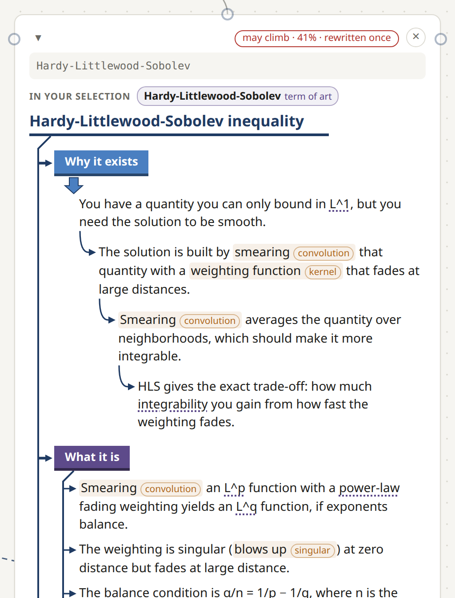
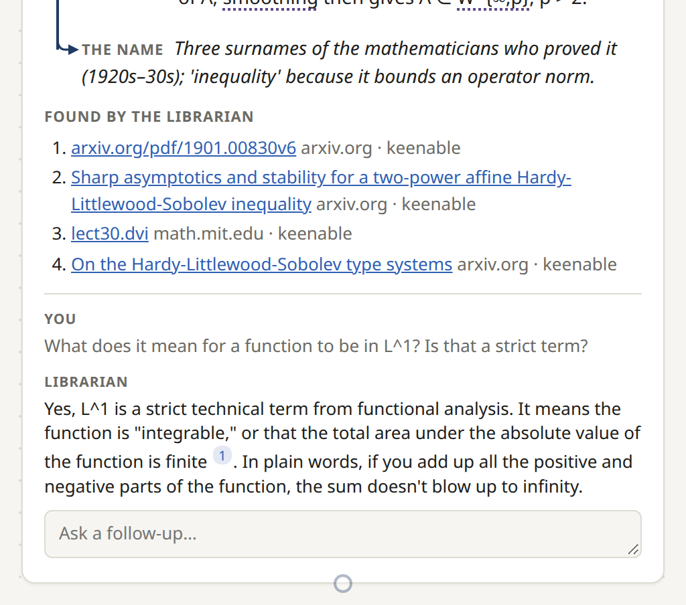
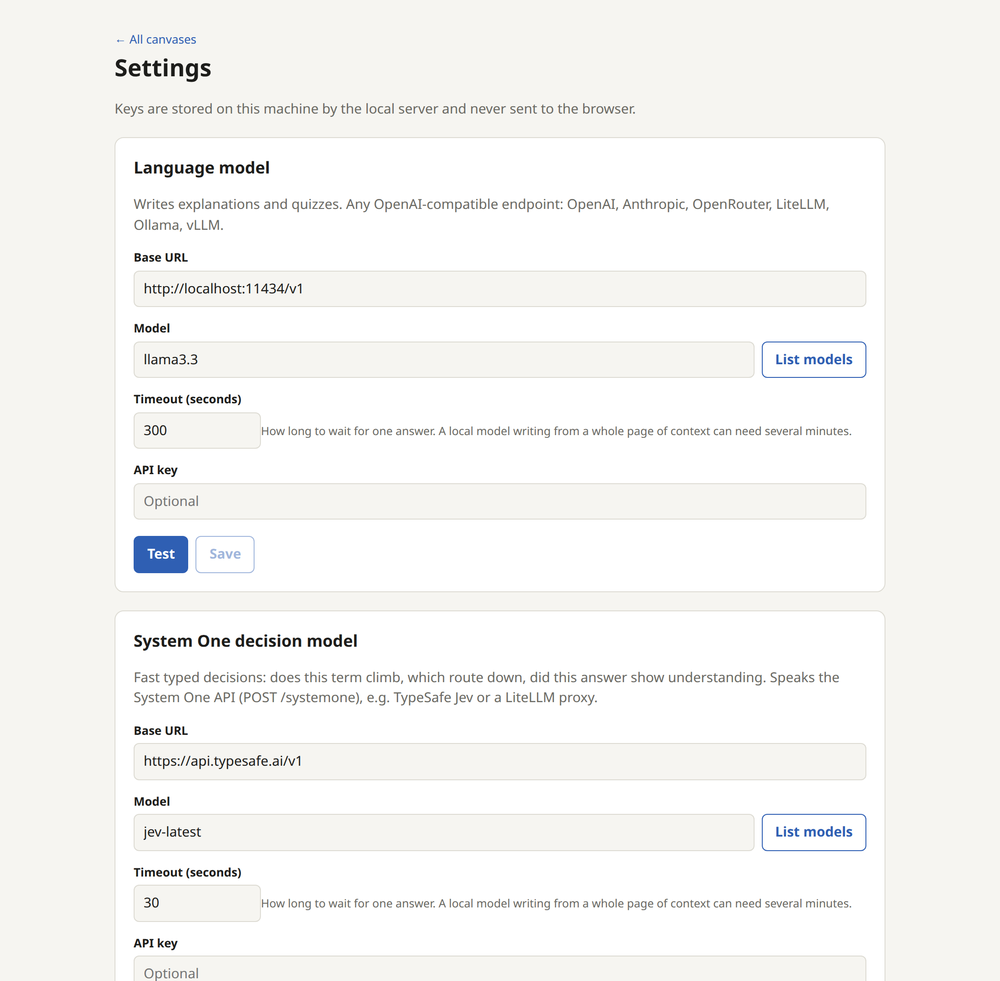

# Librarian

**A research librarian with unlimited time, on an infinite desk that never gets rearranged.**


## The pain

You're curious about something hard. Maybe you're on a Zoom call watching a research talk, and slide 8 says the *Ampère tension field* is what keeps the *Chern-Simons-Schrödinger* system *well-posed in the energy class*. You can read every word. You understand none of it.

That isn't because the ideas are unknowable. Four things get in the way:

**The jargon loop.** Ask what a term means, and the answer uses harder terms, each defined by harder ones still. It's like sitting in Spanish I, asking what a word means, and being answered in Spanish II, then III, then IV, until you're holding a pile of words you don't know. Defining the general through the more specialized is always the wrong direction.

**You can't tell strict words from casual ones.** Mathematical writing switches without warning between terms with exact definitions ("energy space", "well-posed") and loose talk ("+ better", "the worst term", "rougher"). Even the symbols do it: put quote marks around ≲ and it means "roughly". Insiders hear the difference instantly. To an outsider they're all just English words. It's like a fan convention where someone quotes a line from season 4, episode 5, everyone laughs, and you're left asking what show this is.

**Nothing meets you where you are.** Textbooks start years before the slide you care about. Papers and Wikipedia start after it, and Wikipedia's mathematics is a Spanish–Spanish dictionary when you need Spanish–English. "Do I need to explain negative numbers to you?" is a false choice: the ask was never to explain everything, only to stop explaining down-the-hall ideas with across-town ones.

**The tools are built for skimming.** Tabs multiply and you lose the thread. A chat scrolls away into 500k tokens you'll never find again. Brilliant and Duolingo made learning engaging, but over a fixed, shallow curriculum, so people plateau at level 2.

Self-directed deep study does work somewhere: a library, with a good reference librarian who has time for you. That's what this is trying to be.

## What it does

Drop or paste a screenshot of whatever stopped you: a slide, a page, a figure. Drag a box over the part you don't get. The librarian reads it, **looks for introductory material first** (lecture notes, textbook chapters, Khan Academy, Britannica), then draws an explanation beside it that starts with *why the thing exists*, citing what it found.

Explanations are drawn as diagrams, not paragraphs: why it exists as a chain of steps, what it is, a formula split into its parts and joined back together, how it's used on this page, and what its name means.

**Explanations descend toward what you know, never climb.** Select any words in an explanation to go one level further down. A fast decision model checks each draft for climbing into harder jargon than the thing it explains, and asks for a rewrite if it does.

### It tells you which words are strict and which are loose


Before explaining what you selected, the librarian decides whether it's a **term of art**, an **insider idiom**, **informal language**, or **loosened notation**. For loose language it says what's actually meant. Its own plain-language stand-ins ("small push", "tiny bits") are tagged with the real term they replace, so you learn the vocabulary as you go. Strict terms get a dotted underline.



When you box part of a page, it lists the phrases in your selection by register before it explains anything.

### Ask how two things are related


Drag from the dot on any card's edge onto another card. You aren't claiming they're related; you're asking. A relation card appears between them with the connecting idea, or an honest "they're distinct concepts" when the link is weak.

### Ask about anything, right where it is



Every card has an "Ask about this" box. The conversation stays on that card, and the model gets everything the card knows: the page, how you got there, the explanation, and its sources. No scrolling back through one endless chat.

### The desk stays put

- **Nothing moves unless you move it.** The canvas never reshuffles. Drag cards and images anywhere, and everything hanging off them comes along. An explanation can sit on any side of what it explains, just not on top of it.
- **Nothing is lost.** Every change is an event in an append-only log. Undo and Redo cover adding, moving, removing, collapsing and restacking. Removing hides; it never deletes.
- **Walk the tree.** Collapse any card or image to fold away everything below it. Untangle pushes overlapping cards apart. Bring to front and send to back work as you'd expect.
- **Named canvases with stable URLs** at `/c/<id>`, so you can bookmark a line of inquiry and come back to it.

### Your models, your sources



- **Language model:** any OpenAI-compatible endpoint, such as OpenAI, Anthropic, OpenRouter, LiteLLM, Ollama or vLLM. It needs to read images.
- **Decision model (optional):** a System One endpoint such as TypeSafe's Jev, for the fast typed checks: does this climb, is this word strict or casual.
- **Searchers:** Keenable works with no key. SearXNG, Brave, Exa, Perplexity Sonar, Parallel, You.com and Tavily take your keys.

Keys stay on your machine in `data/config.json` (mode 600, gitignored). The browser never sees them.

## Run

```bash
npm install
npm run dev
```

Then open http://localhost:5173, set up a model under **Settings**, and press **Test**. For a production build, run `npm run build && npm start`, which serves everything from port 8787.

Shortcuts: **V** for select and **H** for pan. Hold **Space** to pan. Ctrl+scroll zooms. **Ctrl+Z** and **Ctrl+Shift+Z** undo and redo. **Ctrl+]** and **Ctrl+[** restack, and adding Shift goes all the way to the front or back.

## Hosting it for other people

Run locally, Librarian has no accounts: it's yours. To put it on a server for others, turn accounts on. Anyone can then sign up; each person sees only their own canvases, and only admins can see or change the models and searchers that everyone shares.

```bash
npm install && npm run build
LIBRARIAN_AUTH=on \
BETTER_AUTH_URL=https://librarian.example.org \
BETTER_AUTH_SECRET=$(openssl rand -hex 32) \
ADMIN_EMAILS=you@example.org \
npm start
```

- **Email and password** sign-up works immediately, with no email service.
- **GitHub and Google** sign-in buttons appear when you set `GITHUB_CLIENT_ID` and `GITHUB_CLIENT_SECRET`, or `GOOGLE_CLIENT_ID` and `GOOGLE_CLIENT_SECRET`. Both are free OAuth apps. Register their callback URLs as `https://<your domain>/api/auth/callback/github` and `.../google`.
- **A domain with HTTPS** is needed for the OAuth providers. The server listens on 127.0.0.1:8787, so put a reverse proxy in front of it. With [Caddy](https://caddyserver.com), which handles certificates itself, this is the whole config:

  ```
  librarian.example.org {
      reverse_proxy 127.0.0.1:8787
  }
  ```

- **Admins** are whoever signs in with an email listed in `ADMIN_EMAILS` (comma-separated). They set up the models and searchers under Settings. Canvases from before accounts were turned on belong to the admins.
- **Accounts** are kept in `data/auth.db` (SQLite), created on first start. Accounts use [Better Auth](https://better-auth.com).
- **Searching for everyone:** Keenable's free keyless use is limited per IP address, which every user on a server shares. Give it a free key, or run your own [SearXNG](https://docs.searxng.org).

## Design

The principles, the worked examples from the talk that started this (Jason Zhao's *The Cauchy problem for Manton's Chern-Simons-Schrödinger equation*), prior art, and the roadmap are in [docs/DESIGN.md](docs/DESIGN.md).

## Data

- Canvases live in `data/canvases/<id>.jsonl`, one append-only log each, named in `data/canvases/index.json`.
- Images are stored by content hash in `data/assets/`.
- All of `data/` is gitignored.
